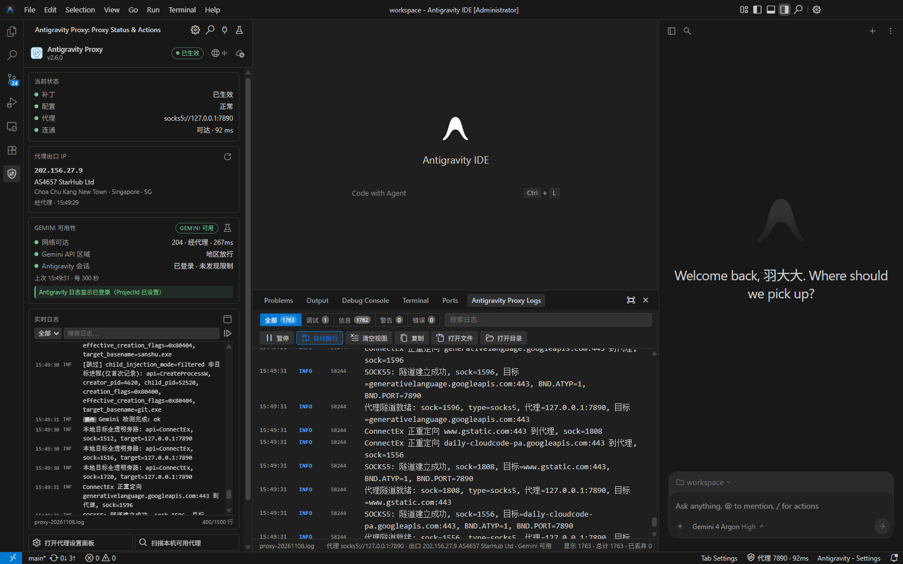
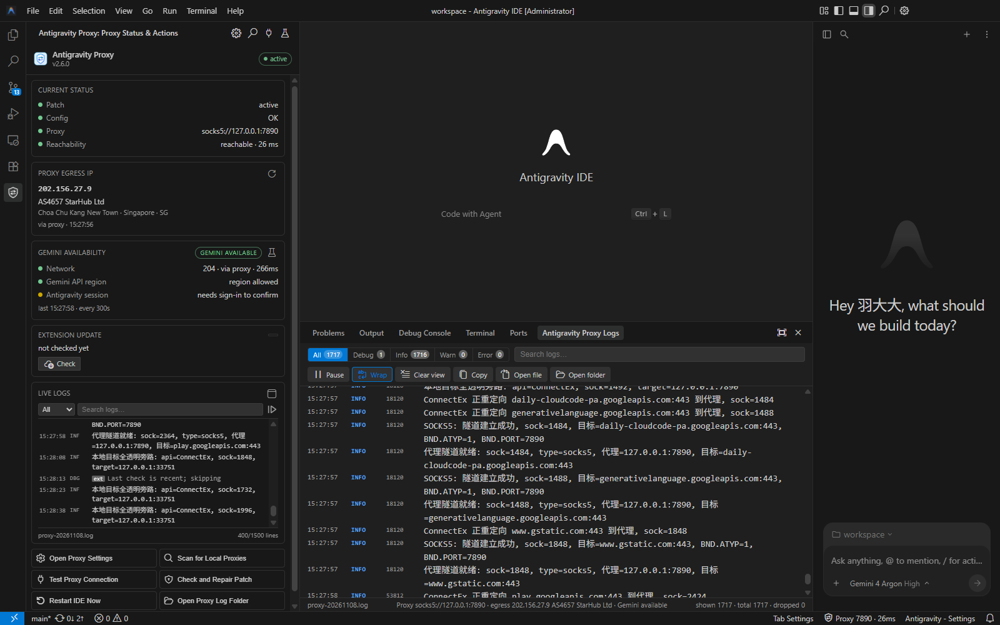
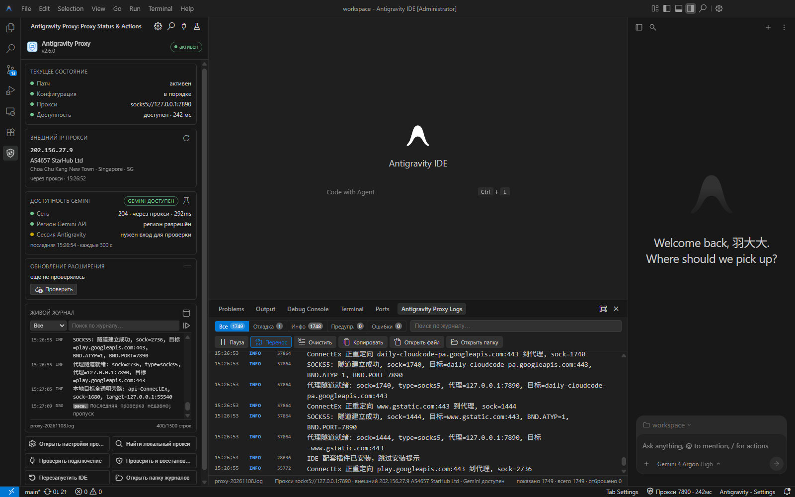

<p align="center">
  
</p>

<h1 align="center">Antigravity-Proxy</h1>

<p align="center">
  <b>🚀 让 Antigravity 不开 TUN 模式也能稳定走代理</b>
</p>

<p align="center">
  <a href="https://github.com/yuaotian/antigravity-proxy/actions"></a>
  <a href="LICENSE.txt"></a>
  
</p>

<p align="center">
  <a href="README_EN.md">🇬🇧 English</a> |
  <a href="README_RU.md">🇷🇺 Русский</a>
</p>

---

## 简介

Antigravity-Proxy 是一个放进 Antigravity 安装目录即可生效的代理补丁（DLL）：

- 只代理 Antigravity 相关进程，不接管系统其他流量；
- 不需要 TUN 模式，也不需要管理员权限；
- 支持 SOCKS5 / HTTP 代理（含账号密码认证）；
- 支持 **Antigravity IDE**、**Antigravity**（桌面版）与 **Antigravity CLI**（`agy`）；
- Antigravity IDE 附带配套插件：状态栏代理状态、可视化设置、实时日志、出口 IP/Gemini 检测、插件自更新，IDE 更新后自动恢复补丁。

## 赞助商

> 📣 **广告位招租**：本 README 长期开放广告位，面向代理 IP / 云服务 / 开发工具等同类产品，支持「图片 + 跳转链接 + 短文案」，按月投放。合作请联系微信 **`JavaRookie666`**（优先，回复最快），或 Telegram [@yuaotian](https://t.me/yuaotian)。

<table>
  <tr>
    <td align="center" colspan="2">
      <a href="https://www.ipwo.net/?ref=githubantigravityproxy">
        
      </a>
    </td>
  </tr>
  <tr>
    <td colspan="2">
      <b>IPWO 住宅代理</b>覆盖 195+ 个国家和地区，拥有 9000 万+ 活跃住宅 IP 资源，支持动态住宅、静态住宅及不限量代理。<br/>
      适用于跨境电商、海外社媒运营、SEO 监控、广告验证及数据采集等场景，为全球业务提供灵活的网络连接方案。
    </td>
  </tr>
  <tr>
    <td align="center" width="50%">💡 <b>静态 IP 低至 9.9</b></td>
    <td align="center" width="50%">🎟️ 优惠折扣码 <code>0200</code>（立减 10%）</td>
  </tr>
  <tr>
    <td align="center" colspan="2">
      <a href="https://www.ipwo.net/?ref=githubantigravityproxy"><b>👉 立即前往 IPWO 选购</b></a>
    </td>
  </tr>
</table>

<!-- 广告投放期：2026-11-09 ~ 2026-12-09（仅源码可见，不渲染） -->

## 安装

### 方式一：Antigravity IDE 插件市场（推荐）

Antigravity IDE 用户优先从 Open VSX 安装插件：

- [Open VSX 市场页面](https://open-vsx.org/extension/yuaotian/antigravity-proxy)
- 在 IDE 扩展视图搜索 `Antigravity Proxy`，或执行：

```powershell
& "$env:LOCALAPPDATA\Programs\Antigravity IDE\bin\antigravity-ide.cmd" --install-extension yuaotian.antigravity-proxy
```

安装后执行 `Reload Window`。插件首次启动会自动补齐 `version.dll`；如果市场搜索不到，按「Antigravity IDE 插件」一节的 VSIX / 命令行兜底；仍然不行再用下面的在线安装脚本。

### 方式二：在线安装脚本（桌面版 / CLI / 插件兜底）

在 PowerShell 中粘贴执行：

```powershell
[Net.ServicePointManager]::SecurityProtocol=3072; & ([scriptblock]::Create((New-Object Net.WebClient).DownloadString('https://wget.la/https://raw.githubusercontent.com/yuaotian/antigravity-proxy/main/scripts/install-online.ps1')))
```

脚本会自动检测已安装的产品，下载对应版本并做 SHA256 校验，部署补丁和 `config.json`，Antigravity IDE 会同时安装配套插件。已有的 `config.json` 不会被覆盖。下载顺序：本机代理（环境变量或系统代理，端口可连才用）→ 镜像 → 直连 GitHub，每个下载源最多重试 3 次。

需要指定参数时加在命令末尾，例如 `... install-online.ps1'))) -Product ide`：

| 参数 | 说明 |
|:--|:--|
| `-Product ide\|desktop\|cli\|all` | 只安装指定产品（默认检测到多个时询问） |
| `-Version 2.5` | 安装指定版本（默认最新） |
| `-InstallDir <目录>` | 手动指定安装目录（与主程序同级） |
| `-ProxyPort 7897` | 指定本地代理端口（默认自动探测） |
| `-Yes` | 不询问，直接安装 |
| `-ExtensionOnly` | 只安装 IDE 配套插件，不动补丁与配置（IDE 运行中也可执行） |

> 获取脚本失败时，打开代理软件的「系统代理」后重试。部署前请先完全退出要安装的应用（`-ExtensionOnly` 除外）。
> 脚本兼容 Windows 10 / 11 自带的 Windows PowerShell 5.1，也可在 PowerShell 7 中运行。

### 方式三：下载发布包

从 [Releases](https://github.com/yuaotian/antigravity-proxy/releases) 下载（32 位程序选 `x86`）：

| 文件 | 适用 |
|:--|:--|
| `antigravity-proxy-vX-ide-win-x64.zip` | Antigravity IDE（`Antigravity IDE.exe`）、Antigravity 桌面版（`Antigravity.exe`） |
| `antigravity-proxy-vX-cli-win-x64.zip` | Antigravity CLI（`agy.exe`） |
| `antigravity-proxy-vX-ide-extension-win-x64.vsix` | IDE 配套插件（IDE 包的 `ide/` 里已包含） |
| `SHA256SUMS.txt` | 校验清单 |

**请解压到安装目录之外**（例如 `%LOCALAPPDATA%\antigravity-proxy\`），日后修复补丁时要用到这份文件。然后任选一种：

- **`setup.bat`**：配置向导，创建「Antigravity (代理)」独立启动入口，每次启动自动补回被更新清除的补丁；
- **`doctor.bat`**：一键部署 / 体检 / 修复（详见 [docs/doctor.md](docs/doctor.md)）；
- **手动复制**：IDE / 桌面版把 `ide/` 里的全部文件复制到主程序同级目录；CLI 把 `cli/` 里的文件复制到 `agy.exe` 同级目录。`ide/` 与 `cli/` 不要混放。

默认安装目录（找不到时：右键快捷方式 → 打开文件所在的位置）：

| 产品 | 目录 |
|:--|:--|
| Antigravity IDE | `%LOCALAPPDATA%\Programs\Antigravity IDE` |
| Antigravity | `%LOCALAPPDATA%\Programs\Antigravity` |
| Antigravity CLI | `%LOCALAPPDATA%\agy\bin`（或执行 `where agy` 查看） |

部署后重启应用即可生效。

## Antigravity IDE 插件

- **状态栏**：底部只占一个条目，显示代理状态，点击打开设置面板；出口 IP·运营商、Gemini 结论、插件更新都收在同一个悬浮卡片里；
- **左侧栏**：补丁/配置/代理/连通状态、出口 IP、Gemini 三层结论、实时日志与快捷操作；插件更新入口收在顶部图标里，不再占一张卡片；顶部地球图标可直接切换 中 / EN / RU；
- **日志窗口**：底部面板内置，支持级别筛选、关键字搜索、暂停/复制、打开文件/目录；侧栏日志区同步加高，约多显示 8 行；
- **设置面板**：可视化修改代理，保存前可「测试连接」，自动备份旧配置；顶栏新增界面语言下拉，切换后即时生效；
- **首次引导**：代理不可用时自动打开设置并扫描本机代理（当前配置、IDE 代理设置、系统代理、环境变量、常用端口），找到后一键填入；
- **Gemini 检测**：网络 / Gemini API 区域 / Antigravity 会话三层判定，可自定义定时并联动左侧栏；
- **补丁守护**：IDE 更新删掉补丁后，下次启动自动恢复（会提示重启）；
- **自更新**：本地代理 → GitHub 镜像 → 直连检查新版本，下载后校验 SHA256 再安装；
- 界面支持中文 / English / Русский，默认跟随 IDE 语言。

### 安装插件（推荐：Open VSX 市场）

**最佳方式**：打开 [Open VSX 市场页面](https://open-vsx.org/extension/yuaotian/antigravity-proxy)，或在 Antigravity IDE 扩展视图搜索 `Antigravity Proxy` 点击安装。也可命令行走市场安装：

```powershell
& "$env:LOCALAPPDATA\Programs\Antigravity IDE\bin\antigravity-ide.cmd" --install-extension yuaotian.antigravity-proxy
```

安装后执行 `Reload Window`；插件首次启动会自动补齐 `version.dll`。

**如果搜索不到 / 安装失败**：

1. 从 [Open VSX 页面](https://open-vsx.org/extension/yuaotian/antigravity-proxy) 或 [GitHub Releases](https://github.com/yuaotian/antigravity-proxy/releases) 下载 VSIX；
2. 扩展视图右上角 `…` → 「从 VSIX 安装」；或：

```powershell
$vsix = Join-Path $env:TEMP "antigravity-proxy-2.6.3.vsix"
[Net.ServicePointManager]::SecurityProtocol = 3072
Invoke-WebRequest "https://open-vsx.org/api/yuaotian/antigravity-proxy/2.6.3/file/yuaotian.antigravity-proxy-2.6.3.vsix" -OutFile $vsix
& "$env:LOCALAPPDATA\Programs\Antigravity IDE\bin\antigravity-ide.cmd" --install-extension $vsix --force
```

（版本号按当前 Release 替换；也可以从 GitHub Releases 下载后把路径换成实际 VSIX。）

**仍然失败：在线脚本（只装插件，中文可走 wget.la 镜像）**：

```powershell
[Net.ServicePointManager]::SecurityProtocol=3072; & ([scriptblock]::Create((New-Object Net.WebClient).DownloadString('https://wget.la/https://raw.githubusercontent.com/yuaotian/antigravity-proxy/main/scripts/install-online.ps1'))) -ExtensionOnly -Yes
```

| 状态栏 | 含义 |
|:--|:--|
| `代理 7890` | 补丁已生效，代理端口可达 |
| `代理 · 缺少 agy.exe` | `target_processes` 缺少 IDE 后端进程，代理对对话无效；悬浮提示里点「一键补齐」 |
| `代理 · 待重启` | 配置或补丁已更新，重启 IDE 后生效 |
| `代理 7890 不可达` | 代理软件未启动或端口不对 |
| `代理补丁缺失` / `代理配置异常` | `version.dll` 被删除 / `config.json` 缺失或无法解析 |
| `代理已禁用` | `proxy.port = 0`，全部直连 |

| 设置项 | 默认 | 说明 |
|:--|:--|:--|
| `antigravityProxy.language` | `auto` | 界面语言：`auto` / `zh-cn` / `en` / `ru` |
| `antigravityProxy.patchGuard.autoRestore` | `true` | 启动时自动恢复被更新清除的补丁 |
| `antigravityProxy.statusBar.enabled` | `true` | 是否显示状态栏 |
| `antigravityProxy.statusBar.probeIntervalSeconds` | `60` | 代理连通检测间隔（秒）；`0` 只在启动和保存后检测 |

### 界面预览

| 简体中文 | English | Русский |
|:--:|:--:|:--:|
|  |  |  |

> 截图来自 Antigravity IDE 1.107.0（Windows），左侧栏与底部「代理日志」面板；IDE 自身的菜单语言跟随 IDE 安装，插件文案由 `antigravityProxy.language` 控制。

更多说明见 [docs/ide-extension.md](docs/ide-extension.md)。

## 配置

配置文件是安装目录下的 `config.json`，最常改的是代理地址：

```json
{
  "proxy": {
    "host": "127.0.0.1",
    "port": 7890,
    "type": "socks5",
    "username": "",
    "password": ""
  }
}
```

- `type`：`socks5`（推荐）或 `http`；`port` 设为 `0` 表示全部直连；
- 修改方式：IDE 插件设置面板，或用浏览器打开发布包里的 `config-web.html` 编辑后导出；
- 修改后需重启应用；
- 完整配置项（目标进程、路由规则、IPv6 / UDP 等）见 [docs/configuration.md](docs/configuration.md)。

## 应用更新后补丁失效

Antigravity 自动更新可能会删除安装目录里的补丁文件：

- **Antigravity IDE**：插件会在下次启动时自动恢复，按提示重启即可；
- **Antigravity 桌面版**：从「Antigravity (代理)」入口启动会自动补回；或运行发布包里的 `doctor.bat -Action Repair`；
- **Antigravity CLI**：运行发布包里的 `doctor.bat -Action Repair`，或重新执行在线安装。

在线安装的发布包位于 `%LOCALAPPDATA%\antigravity-proxy\<版本>\`，安装结束时也会打印修复命令。

## 常见问题

**对话报错 `Agent execution terminated due to error` / `User location is not supported`？**
多数是代理出口 IP 不被服务端接受（常见于机房 / 托管 IP），请换成普通家宽类型的节点再试。补丁日志里能看到「已注入新建进程」和「SOCKS5: 隧道建立成功」就说明补丁本身正常。详见 [docs/agent-ip-diagnosis.md](docs/agent-ip-diagnosis.md)。

**不走代理、主页白屏？**
先运行 `doctor.bat`（只读体检），它会告诉你是补丁丢失、没被加载、代理端口不通，还是 `proxy.type` 与端口协议不符，并给出下一步操作。

**报错里出现 `198.18.x.x` 被拒绝 / 超时？**
`198.18.x.x` 是补丁分配给域名的内部占位地址（FakeIP），不是真实目标；出现在报错里通常说明**连代理失败**：检查代理软件是否启动、端口是否正确、`proxy.type` 是否与端口协议一致（混合端口两者皆可；HTTP 专用端口要填 `http`）。`doctor.bat` 会自动探测端口协议。

**日志在哪？**
`<安装目录>\logs\proxy-YYYYMMDD.log`；目录不可写时在 `%TEMP%\antigravity-proxy-logs\`。

**启动报错？**

| 错误 | 处理 |
|:--|:--|
| `0xC0000142` / `0xC000007B` | 补丁与程序架构不一致（x86 / x64），换对应版本；或缺少运行库，安装 [`microsoft/微软常用运行库合集-2025.exe`](microsoft/微软常用运行库合集-2025.exe) |
| `0xC0000135` / 缺少 `VCRUNTIME140_1.dll` | 安装上面的运行库合集 |
| `0xC0000906` | 被安全软件拦截，把安装目录加入白名单 |
| 日志里 `10061` / `10060` | 代理软件未启动或端口错误 / 连接超时；日志提示「可能是 HTTP 代理端口」/「可能是 SOCKS5 端口」时改 `proxy.type` |

**WSL 里能用吗？**
不能：补丁只作用于 Windows 进程。WSL 的替代方案见 [docs/wsl.md](docs/wsl.md)。

更多排查步骤见 [docs/troubleshooting.md](docs/troubleshooting.md)；仍未解决请提交 [Issue](https://github.com/yuaotian/antigravity-proxy/issues) 并附上日志与 `config.json`（隐去密码）。

## 文档

| 文档 | 内容 |
|:--|:--|
| [docs/configuration.md](docs/configuration.md) | 完整配置项、路由规则、IPv6 / UDP、代理其他程序 |
| [docs/troubleshooting.md](docs/troubleshooting.md) | 故障排查手册、错误码 |
| [docs/doctor.md](docs/doctor.md) | 一键部署 / 体检 / 修复脚本 |
| [docs/ide-extension.md](docs/ide-extension.md) | IDE 插件 |
| [docs/wsl.md](docs/wsl.md) | WSL 替代方案 |
| [docs/DEVELOPMENT.md](docs/DEVELOPMENT.md) | 编译构建、工作原理、二次开发 |

## 编译

需要 Visual Studio 2022（C++ 桌面开发）与 CMake，执行 `.\build.ps1` 即可在 `output/` 得到全部产物。详见 [docs/DEVELOPMENT.md](docs/DEVELOPMENT.md)。

## 许可证

[BSD-2-Clause](LICENSE.txt)。MinHook 部分版权归 Tsuda Kageyu 所有（`AUTHORS.txt` 为 MinHook 作者名单）。

## 关于作者

**煎饼果子（86）**，独立开发者。

| 平台 | 信息 |
|------|------|
| **微信** | JavaRookie666 |
| **Telegram** | [@yuaotian](https://t.me/yuaotian) |
| **GitHub** | [@yuaotian](https://github.com/yuaotian) |

如果这个项目对你有帮助，欢迎点个 ⭐、分享给需要的朋友，或提交 Issue / PR。

<table>
  <tr>
    <td align="center">
      <br/>
      <sub>添加微信交流</sub>
    </td>
    <td align="center">
      <br/>
      <sub>关注公众号</sub>
    </td>
    <td align="center">
      <br/>
      <sub>🔥 加入微信交流群</sub>
    </td>
  </tr>
</table>

### 打赏支持

如果这个项目帮到了你，可以请作者喝杯咖啡 ☕

<table>
  <tr>
    <td align="center">
      <br/>
      <sub>微信赞赏</sub>
    </td>
    <td align="center">
      <br/>
      <sub>支付宝打赏</sub>
    </td>
  </tr>
</table>

## 伪代码（pseudocode_dll）来源说明

`pseudocode_dll/` 收录了对某论坛帖中发布的 DLL 反编译得到的伪代码（Binary Ninja / IDA Hex-Rays），仅用于排查 Windows 11 下的崩溃问题与学习对照：

- 不参与本项目的构建与发布；本项目代码为从零实现并持续维护，并非原 DLL 的源码；
- 本仓库不分发原帖中的 DLL，如需获取请前往原帖：https://linux.do/t/topic/1189424；
- 若原帖作者希望移除相关内容，请提 Issue，我会第一时间配合。

---

<p align="center">
  <sub>Made with ❤️ by 煎饼果子（86）</sub>
</p>
