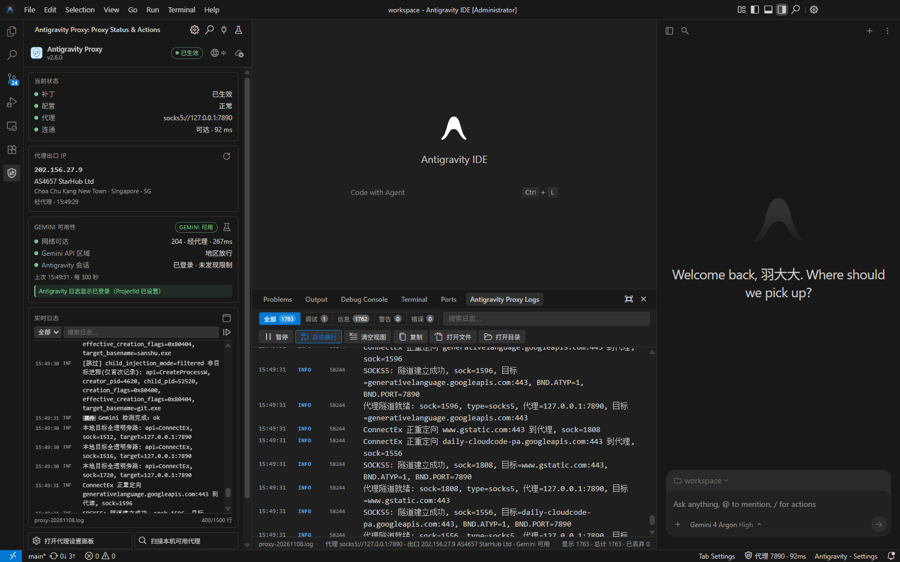
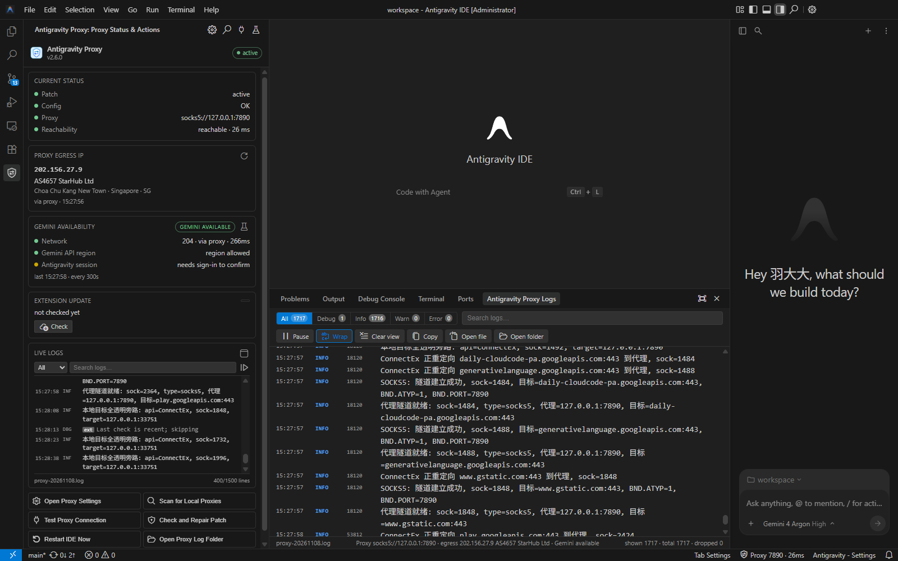
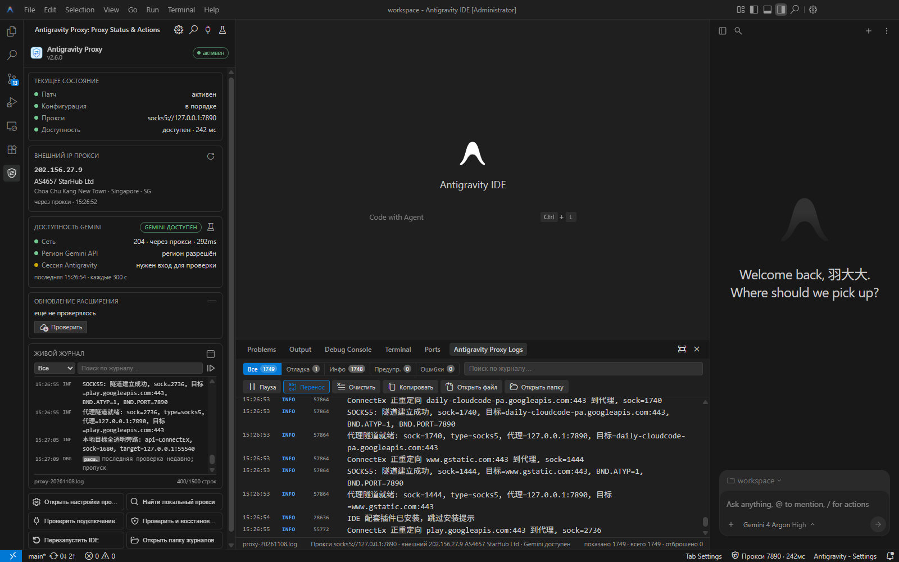

<p align="center">
  
</p>

<h1 align="center">Antigravity-Proxy</h1>

<p align="center">
  <b>🚀 Run Antigravity through a proxy reliably, without TUN mode</b>
</p>

<p align="center">
  <a href="https://github.com/yuaotian/antigravity-proxy/actions"></a>
  <a href="LICENSE.txt"></a>
  
</p>

<p align="center">
  <a href="README.md">🇨🇳 中文</a> |
  <a href="README_RU.md">🇷🇺 Русский</a>
</p>

---

## Introduction

Antigravity-Proxy is a proxy patch (DLL) that works once you put it in the Antigravity install directory:

- Proxies only Antigravity-related processes; other system traffic is left alone;
- No TUN mode and no administrator rights needed;
- Supports SOCKS5 / HTTP proxies (including username/password authentication);
- Supports **Antigravity IDE**, **Antigravity** (desktop) and **Antigravity CLI** (`agy`);
- Antigravity IDE comes with a companion extension: proxy status, visual settings, live logs, egress IP/Gemini checks, extension self-update, and automatic patch restore after IDE updates.

## Sponsor

> 📣 **Ad space available**: this README takes paid placements for proxy IP / cloud / dev-tool products — image + link + short copy, booked by the month. Get in touch: [@yuaotian](https://t.me/yuaotian).

<table>
  <tr>
    <td align="center" colspan="2">
      <a href="https://www.ipwo.net/?ref=githubantigravityproxy">
        
      </a>
    </td>
  </tr>
  <tr>
    <td colspan="2">
      <b>IPWO residential proxies</b> cover 195+ countries and regions with 90M+ active residential IPs, offering rotating, static and unlimited proxy plans.<br/>
      Built for cross-border e-commerce, overseas social media operations, SEO monitoring, ad verification and data collection — a flexible network layer for global business.
    </td>
  </tr>
  <tr>
    <td align="center" width="50%">💡 <b>Static IP from 9.9</b></td>
    <td align="center" width="50%">🎟️ Promo code <code>0200</code> (10% off)</td>
  </tr>
  <tr>
    <td align="center" colspan="2">
      <a href="https://www.ipwo.net/?ref=githubantigravityproxy"><b>👉 Get IPWO residential proxies</b></a>
      <br/><sub>Ad run: 2026-11-09 ~ 2026-12-09</sub>
    </td>
  </tr>
</table>

## Installation

### Option 1: Antigravity IDE Marketplace (recommended)

For Antigravity IDE, install the extension from Open VSX first:

- [Antigravity Proxy on Open VSX](https://open-vsx.org/extension/yuaotian/antigravity-proxy)
- Search for `Antigravity Proxy` in the Extensions view, or run:

```powershell
& "$env:LOCALAPPDATA\Programs\Antigravity IDE\bin\antigravity-ide.cmd" --install-extension yuaotian.antigravity-proxy
```

Reload the IDE window after installation. The extension restores `version.dll` on its first start. If the marketplace search does not find it, use the VSIX / CLI fallback in the "Antigravity IDE Extension" section; if that still fails, use the online script below.

### Option 2: Online install script (desktop / CLI / extension fallback)

Paste and run in PowerShell:

```powershell
[Net.ServicePointManager]::SecurityProtocol=3072; & ([scriptblock]::Create((New-Object Net.WebClient).DownloadString('https://raw.githubusercontent.com/yuaotian/antigravity-proxy/main/scripts/install-online.ps1')))
```

The script detects installed products, downloads the matching version and verifies SHA256, and deploys the patch and `config.json`. For Antigravity IDE it also installs the companion extension. An existing `config.json` is not overwritten. Download order: local proxy (environment variable or system proxy, used only if its port is reachable) → mirrors → direct GitHub, with up to 3 attempts per source.

To pass parameters, add them at the end of the command, e.g. `... install-online.ps1'))) -Product ide`:

| Parameter | Description |
|:--|:--|
| `-Product ide\|desktop\|cli\|all` | Install only the given product (by default, asks when several are detected) |
| `-Version 2.5` | Install a specific version (default: latest) |
| `-InstallDir <dir>` | Set the install directory manually (the folder containing the main executable) |
| `-ProxyPort 7897` | Set the local proxy port (default: auto-detected) |
| `-Yes` | Install without prompting |
| `-ExtensionOnly` | Install only the IDE companion extension; patch and config are untouched (works while the IDE is running) |

> If the script cannot be downloaded, turn on "System Proxy" in your proxy app and try again. Fully quit the app you are installing for before deploying (not needed for `-ExtensionOnly`).
> The script works with Windows PowerShell 5.1 built into Windows 10 / 11, and with PowerShell 7.

### Option 3: Download a release package

Download from [Releases](https://github.com/yuaotian/antigravity-proxy/releases) (choose `x86` for 32-bit programs):

| File | For |
|:--|:--|
| `antigravity-proxy-vX-ide-win-x64.zip` | Antigravity IDE (`Antigravity IDE.exe`), Antigravity desktop (`Antigravity.exe`) |
| `antigravity-proxy-vX-cli-win-x64.zip` | Antigravity CLI (`agy.exe`) |
| `antigravity-proxy-vX-ide-extension-win-x64.vsix` | IDE companion extension (already included in `ide/` of the IDE package) |
| `SHA256SUMS.txt` | Checksum list |

**Extract it outside the install directory** (e.g. `%LOCALAPPDATA%\antigravity-proxy\`); you will need these files later to repair the patch. Then pick one:

- **`setup.bat`**: setup wizard; creates a separate `Antigravity (Proxy)` shortcut that puts back the patch removed by updates on every launch;
- **`doctor.bat`**: one-click deploy / health check / repair (see [docs/doctor.md](docs/doctor.md));
- **Manual copy**: for IDE / desktop, copy all files in `ide/` into the folder containing the main executable; for CLI, copy the files in `cli/` into the folder containing `agy.exe`. Do not mix `ide/` and `cli/`.

Default install directories (if you cannot find it: right-click the shortcut → Open file location):

| Product | Directory |
|:--|:--|
| Antigravity IDE | `%LOCALAPPDATA%\Programs\Antigravity IDE` |
| Antigravity | `%LOCALAPPDATA%\Programs\Antigravity` |
| Antigravity CLI | `%LOCALAPPDATA%\agy\bin` (or run `where agy`) |

Restart the app after deployment.

## Antigravity IDE Extension

- **Status bar**: one single item at the bottom; click it to open the settings panel. Egress IP/ISP, the Gemini result and extension updates live in the same hover card;
- **Sidebar**: patch/config/proxy/reachability, egress IP, three-layer Gemini result, live logs and quick actions; the update entry is a compact icon in the header (no extra card), and the globe icon switches 中文 / EN / RU instantly;
- **Log window**: built-in bottom panel with level filters, keyword search, pause/copy and open file/folder; the sidebar log area is taller (about 8 more rows);
- **Settings panel**: edit the proxy visually, "Test connection" before saving, old config is backed up automatically; a language selector in the top bar applies immediately;
- **First-run guide**: when the proxy is unavailable, opens the settings and scans for local proxies (current config, IDE proxy settings, system proxy, environment variables, common ports); fill in a found proxy with one click;
- **Gemini check**: three layers (network / Gemini API region / Antigravity session), configurable interval, mirrored in the sidebar;
- **Patch guard**: if an IDE update deletes the patch, it is restored on the next start (you will be asked to restart);
- **Self-update**: local proxy → GitHub mirror → direct, SHA256 verified before install;
- UI in Chinese / English / Russian, following the IDE language by default.

### Install the extension (recommended: Open VSX)

**Best option**: open [Antigravity Proxy on Open VSX](https://open-vsx.org/extension/yuaotian/antigravity-proxy), or search for `Antigravity Proxy` in the Extensions view. You can also install it from the marketplace via CLI:

```powershell
& "$env:LOCALAPPDATA\Programs\Antigravity IDE\bin\antigravity-ide.cmd" --install-extension yuaotian.antigravity-proxy
```

Reload the IDE window after installation; the extension restores `version.dll` on its first start.

**If search does not find it / install fails:**

1. Download the VSIX from [Open VSX](https://open-vsx.org/extension/yuaotian/antigravity-proxy) or [GitHub Releases](https://github.com/yuaotian/antigravity-proxy/releases);
2. Extensions view → `…` → "Install from VSIX..."; or:

```powershell
$vsix = Join-Path $env:TEMP "antigravity-proxy-2.6.3.vsix"
[Net.ServicePointManager]::SecurityProtocol = 3072
Invoke-WebRequest "https://open-vsx.org/api/yuaotian/antigravity-proxy/2.6.3/file/yuaotian.antigravity-proxy-2.6.3.vsix" -OutFile $vsix
& "$env:LOCALAPPDATA\Programs\Antigravity IDE\bin\antigravity-ide.cmd" --install-extension $vsix --force
```

(Replace the version with the current release; you can also download the VSIX from GitHub Releases and pass its path instead.)

**Still failing: online script (extension only, direct GitHub):**

```powershell
[Net.ServicePointManager]::SecurityProtocol=3072; & ([scriptblock]::Create((New-Object Net.WebClient).DownloadString('https://raw.githubusercontent.com/yuaotian/antigravity-proxy/main/scripts/install-online.ps1'))) -ExtensionOnly -Yes
```

| Status bar | Meaning |
|:--|:--|
| `Proxy 7890` | Patch is active, proxy port is reachable |
| `Proxy · missing agy.exe` | `target_processes` lacks the IDE backend process, so chat is not proxied; click "Add missing" in the tooltip |
| `Proxy · restart needed` | Config or patch was updated; takes effect after restarting the IDE |
| `Proxy 7890 unreachable` | Proxy app not running or wrong port |
| `Proxy patch missing` / `Proxy config error` | `version.dll` was deleted / `config.json` is missing or cannot be parsed |
| `Proxy disabled` | `proxy.port = 0`, all connections go direct |

| Setting | Default | Description |
|:--|:--|:--|
| `antigravityProxy.language` | `auto` | UI language: `auto` / `zh-cn` / `en` / `ru` |
| `antigravityProxy.patchGuard.autoRestore` | `true` | Restore a patch removed by an update at startup |
| `antigravityProxy.statusBar.enabled` | `true` | Show the status bar item |
| `antigravityProxy.statusBar.probeIntervalSeconds` | `60` | Proxy reachability check interval (seconds); `0` = check only at startup and after saving |

### Preview

| 简体中文 | English | Русский |
|:--:|:--:|:--:|
|  |  |  |

> Screenshots taken in Antigravity IDE 1.107.0 (Windows): sidebar and the built-in "Proxy Logs" panel. The IDE chrome follows the IDE language; extension strings follow `antigravityProxy.language`.

See [docs/ide-extension.md](docs/ide-extension.md) for more.

## Configuration

The config file is `config.json` in the install directory. The proxy address is what you will change most often:

```json
{
  "proxy": {
    "host": "127.0.0.1",
    "port": 7890,
    "type": "socks5",
    "username": "",
    "password": ""
  }
}
```

- `type`: `socks5` (recommended) or `http`; set `port` to `0` to connect directly for everything;
- How to edit: the IDE extension settings panel, or open `config-web.html` from the release package in a browser, edit, and export;
- Restart the app after changes;
- For all options (target processes, routing rules, IPv6 / UDP, etc.) see [docs/configuration.md](docs/configuration.md).

## Patch Gone After an App Update

Antigravity auto-updates may delete the patch files in the install directory:

- **Antigravity IDE**: the extension restores them on the next start; restart when prompted;
- **Antigravity desktop**: launching from the `Antigravity (Proxy)` shortcut puts them back automatically; or run `doctor.bat -Action Repair` from the release package;
- **Antigravity CLI**: run `doctor.bat -Action Repair` from the release package, or run the online install again.

The release package used by online install is in `%LOCALAPPDATA%\antigravity-proxy\<version>\`; the repair command is also printed at the end of installation.

## FAQ

**Chat fails with `Agent execution terminated due to error` / `User location is not supported`?**
Usually the server does not accept the proxy's egress IP (common with datacenter / hosting IPs). Switch to a regular residential ISP node and try again. If the patch log shows "已注入新建进程" (injected into new process) and "SOCKS5: 隧道建立成功" (tunnel established), the patch itself is working. See [docs/agent-ip-diagnosis.md](docs/agent-ip-diagnosis.md).

**Traffic not proxied, or a blank home page?**
Run `doctor.bat` first (read-only health check). It tells you whether the patch is missing, not loaded, the proxy port is unreachable, or `proxy.type` does not match the port's protocol, and what to do next.

**Errors mention `198.18.x.x` refused / timed out?**
`198.18.x.x` is an internal placeholder address (FakeIP) that the patch assigns to domain names, not the real target. Seeing it in an error usually means **connecting to the proxy failed**: check that the proxy app is running, the port is correct, and `proxy.type` matches the port's protocol (mixed ports accept both; an HTTP-only port needs `http`). `doctor.bat` detects the port's protocol automatically.

**Where are the logs?**
`<install dir>\logs\proxy-YYYYMMDD.log`; if that directory is not writable, `%TEMP%\antigravity-proxy-logs\`.

**Error on startup?**

| Error | Fix |
|:--|:--|
| `0xC0000142` / `0xC000007B` | Patch and program architecture do not match (x86 / x64), use the matching version; or runtime libraries are missing, install the Microsoft runtime bundle [`microsoft/微软常用运行库合集-2025.exe`](microsoft/微软常用运行库合集-2025.exe) |
| `0xC0000135` / missing `VCRUNTIME140_1.dll` | Install the runtime bundle above |
| `0xC0000906` | Blocked by security software; add the install directory to its whitelist |
| `10061` / `10060` in the log | Proxy app not running or wrong port / connection timed out; if the log says the port looks like an HTTP or SOCKS5 port, change `proxy.type` |

**Does it work in WSL?**
No: the patch only works for Windows processes. For alternatives in WSL, see [docs/wsl.md](docs/wsl.md).

For more troubleshooting steps see [docs/troubleshooting.md](docs/troubleshooting.md). If the problem remains, open an [Issue](https://github.com/yuaotian/antigravity-proxy/issues) with your logs and `config.json` (password removed).

## Documentation

| Document (Chinese) | Content |
|:--|:--|
| [docs/configuration.md](docs/configuration.md) | All config options, routing rules, IPv6 / UDP, proxying other programs |
| [docs/troubleshooting.md](docs/troubleshooting.md) | Troubleshooting guide, error codes |
| [docs/doctor.md](docs/doctor.md) | One-click deploy / health check / repair script |
| [docs/ide-extension.md](docs/ide-extension.md) | IDE extension |
| [docs/wsl.md](docs/wsl.md) | WSL alternatives |
| [docs/DEVELOPMENT.md](docs/DEVELOPMENT.md) | Building, how it works, further development |

## Build

Requires Visual Studio 2022 (Desktop development with C++) and CMake. Run `.\build.ps1` to get all build outputs in `output/`. See [docs/DEVELOPMENT.md](docs/DEVELOPMENT.md).

## License

[BSD-2-Clause](LICENSE.txt). MinHook portions are copyright Tsuda Kageyu (`AUTHORS.txt` lists the MinHook authors).

## About the Author

**煎饼果子（86）**, independent developer.

| Platform | Info |
|------|------|
| **WeChat** | JavaRookie666 |
| **Telegram** | [@yuaotian](https://t.me/yuaotian) |
| **GitHub** | [@yuaotian](https://github.com/yuaotian) |

If this project helps you, feel free to give it a ⭐, share it with friends who need it, or submit an Issue / PR.

<table>
  <tr>
    <td align="center">
      <br/>
      <sub>Add WeChat</sub>
    </td>
    <td align="center">
      <br/>
      <sub>Official Account</sub>
    </td>
    <td align="center">
      <br/>
      <sub>🔥 Join WeChat Group</sub>
    </td>
  </tr>
</table>

### Donate

If this project helped you, you can buy the author a coffee ☕

<table>
  <tr>
    <td align="center">
      <br/>
      <sub>WeChat Reward</sub>
    </td>
    <td align="center">
      <br/>
      <sub>Alipay</sub>
    </td>
  </tr>
</table>

## Pseudocode (pseudocode_dll) Source Note

`pseudocode_dll/` contains pseudocode decompiled (Binary Ninja / IDA Hex-Rays) from a DLL published in a forum post. It is used only to investigate crashes on Windows 11 and for study and comparison:

- It is not part of this project's build or release; this project's code is written from scratch and actively maintained, and is not the source code of the original DLL;
- This repository does not distribute the DLL from the original post; to get it, go to the original post: https://linux.do/t/topic/1189424;
- If the original author wants this content removed, please open an Issue and I will act on it right away.

---

<p align="center">
  <sub>Made with ❤️ by 煎饼果子（86）</sub>
</p>
