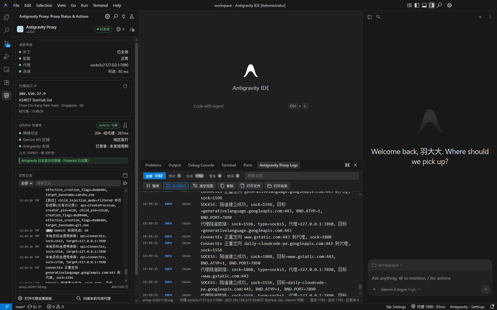
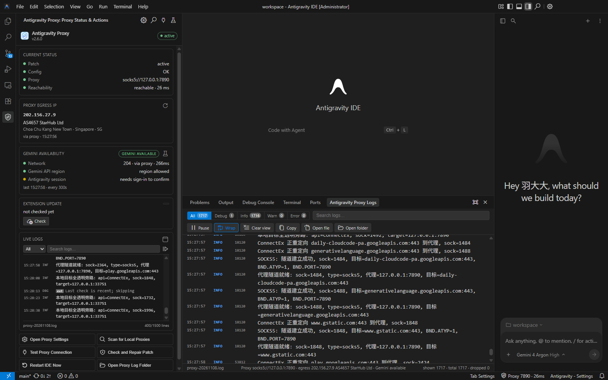
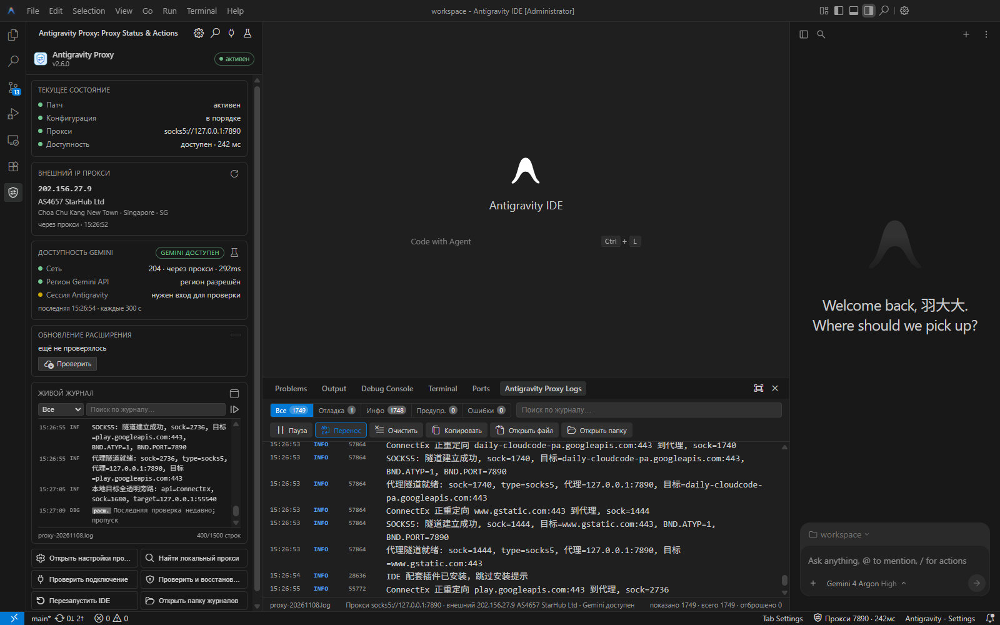

<p align="center">
  
</p>

<h1 align="center">Antigravity-Proxy</h1>

<p align="center">
  <b>🚀 Стабильная работа Antigravity через прокси без режима TUN</b>
</p>

<p align="center">
  <a href="https://github.com/yuaotian/antigravity-proxy/actions"></a>
  <a href="LICENSE.txt"></a>
  
</p>

<p align="center">
  <a href="README.md">🇨🇳 中文</a> |
  <a href="README_EN.md">🇬🇧 English</a>
</p>

---

## Введение

Antigravity-Proxy — это патч прокси (DLL), который начинает работать, как только его положить в каталог установки Antigravity:

- проксирует только процессы Antigravity и не затрагивает остальной трафик системы;
- не требует ни режима TUN, ни прав администратора;
- поддерживает прокси SOCKS5 / HTTP (в том числе с аутентификацией по логину и паролю);
- поддерживает **Antigravity IDE**, **Antigravity** (настольная версия) и **Antigravity CLI** (`agy`);
- для Antigravity IDE есть расширение: состояние прокси, визуальные настройки, живой журнал, проверка внешнего IP/Gemini, самообновление расширения и автоматическое восстановление патча после обновления IDE.

## Установка

### Способ 1: онлайн-установка (рекомендуется)

Вставьте в PowerShell и выполните:

```powershell
[Net.ServicePointManager]::SecurityProtocol=3072; & ([scriptblock]::Create((New-Object Net.WebClient).DownloadString('https://wget.la/https://raw.githubusercontent.com/yuaotian/antigravity-proxy/main/scripts/install-online.ps1')))
```

Скрипт сам определит установленные продукты, скачает нужную версию с проверкой SHA256, развернёт патч и `config.json`, а для Antigravity IDE заодно установит расширение. Существующий `config.json` не перезаписывается. Порядок загрузки: локальный прокси (переменная окружения или системный прокси, только если порт доступен) → зеркала → напрямую GitHub, до 3 попыток на каждый источник.

Параметры добавляйте в конец команды, например `... install-online.ps1'))) -Product ide`:

| Параметр | Описание |
|:--|:--|
| `-Product ide\|desktop\|cli\|all` | Установить только указанный продукт (по умолчанию, если найдено несколько, скрипт спросит) |
| `-Version 2.5` | Установить указанную версию (по умолчанию — последнюю) |
| `-InstallDir <каталог>` | Указать каталог установки вручную (каталог основной программы) |
| `-ProxyPort 7897` | Указать порт локального прокси (по умолчанию определяется автоматически) |
| `-Yes` | Устанавливать без вопросов |
| `-ExtensionOnly` | Установить только расширение для IDE; патч и конфигурация не меняются (можно при запущенной IDE) |

> Если скрипт не скачивается, включите «системный прокси» в прокси-клиенте и повторите попытку. Перед развёртыванием полностью закройте приложение, в которое ставите патч (для `-ExtensionOnly` не нужно).
> Скрипт работает во встроенной в Windows 10 / 11 Windows PowerShell 5.1 и в PowerShell 7.

### Способ 2: скачать пакет релиза

Скачайте из [Releases](https://github.com/yuaotian/antigravity-proxy/releases) (для 32-разрядных программ выбирайте `x86`):

| Файл | Для чего |
|:--|:--|
| `antigravity-proxy-vX-ide-win-x64.zip` | Antigravity IDE (`Antigravity IDE.exe`), Antigravity, настольная версия (`Antigravity.exe`) |
| `antigravity-proxy-vX-cli-win-x64.zip` | Antigravity CLI (`agy.exe`) |
| `antigravity-proxy-vX-ide-extension-win-x64.vsix` | Расширение для IDE (уже есть в `ide/` пакета для IDE) |
| `SHA256SUMS.txt` | Контрольные суммы |

**Распакуйте вне каталога установки** (например, в `%LOCALAPPDATA%\antigravity-proxy\`): эти файлы понадобятся позже для восстановления патча. Затем выберите любой вариант:

- **`setup.bat`**: мастер настройки; создаёт отдельный ярлык запуска «Antigravity (Прокси)», который при каждом запуске возвращает патч, удалённый обновлением;
- **`doctor.bat`**: развёртывание / проверка / восстановление одной командой (подробнее: [docs/doctor.md](docs/doctor.md));
- **ручное копирование**: для IDE / настольной версии скопируйте все файлы из `ide/` в каталог основной программы; для CLI — файлы из `cli/` в каталог с `agy.exe`. Не смешивайте `ide/` и `cli/`.

Каталоги установки по умолчанию (если не можете найти: правой кнопкой по ярлыку → «Расположение файла»):

| Продукт | Каталог |
|:--|:--|
| Antigravity IDE | `%LOCALAPPDATA%\Programs\Antigravity IDE` |
| Antigravity | `%LOCALAPPDATA%\Programs\Antigravity` |
| Antigravity CLI | `%LOCALAPPDATA%\agy\bin` (или выполните `where agy`) |

После развёртывания перезапустите приложение.

## Расширение для Antigravity IDE

- **Строка состояния**: один элемент внизу; щелчок открывает панель настроек. Внешний IP/провайдер, результат Gemini и обновления расширения — в той же всплывающей карточке;
- **Боковая панель**: состояние патча/конфигурации/прокси/доступности, внешний IP, три уровня проверки Gemini, живой журнал и быстрые действия; обновление вынесено в компактную иконку заголовка (без отдельной карточки), глобус переключает 中 / EN / RU;
- **Окно журнала**: встроено в нижнюю панель; фильтр по уровню, поиск по ключевым словам, пауза/копирование, открытие файла/папки; область журнала в боковой панели стала выше (примерно +8 строк);
- **Панель настроек**: визуальное изменение прокси, перед сохранением можно «Проверить подключение», старая конфигурация автоматически копируется в резерв; селектор языка в верхней панели применяется сразу;
- **Первая настройка**: если прокси недоступен, расширение само открывает настройки и ищет прокси на компьютере (текущая конфигурация, настройки прокси IDE, системный прокси, переменные окружения, распространённые порты) и подставляет найденный одним щелчком;
- **Проверка Gemini**: три уровня (сеть / регион Gemini API / сессия Antigravity), настраиваемый интервал, результат дублируется в боковой панели;
- **Защита патча**: если обновление IDE удалило патч, при следующем запуске он восстанавливается автоматически (с предложением перезапустить IDE);
- **Самообновление**: локальный прокси → зеркало GitHub → напрямую, перед установкой проверяется SHA256;
- интерфейс: 中文 / English / Русский, по умолчанию — язык IDE.

**Установка**: онлайн-установка и `doctor` устанавливают расширение автоматически. Если после ручного развёртывания расширение не установлено, при запуске IDE появится системное уведомление (один раз для каждой версии патча; если его проигнорировать, напоминаний больше не будет). Если пакет расширения лежит рядом с патчем, щелчок по уведомлению установит его локально; если скопирован только `version.dll`, после щелчка появится запрос подтверждения, затем откроется окно PowerShell для онлайн-установки расширения. Также можно так: представление «Расширения» → `…` в правом верхнем углу → «Установить из VSIX…».

**Установка из Open VSX**: найдите `Antigravity Proxy` в представлении расширений или выполните:

```powershell
& "$env:LOCALAPPDATA\Programs\Antigravity IDE\bin\antigravity-ide.cmd" --install-extension yuaotian.antigravity-proxy
```

После установки выполните `Reload Window`.

| Строка состояния | Значение |
|:--|:--|
| `Прокси 7890` | Патч работает, порт прокси доступен |
| `Прокси · нет agy.exe` | В `target_processes` нет фонового процесса IDE, чат не идёт через прокси; нажмите «Добавить» во всплывающей подсказке |
| `Прокси · нужен перезапуск` | Конфигурация или патч обновлены, изменения вступят в силу после перезапуска IDE |
| `Прокси 7890 недоступен` | Прокси-клиент не запущен или указан неверный порт |
| `Нет патча прокси` / `Ошибка конфигурации` | `version.dll` удалён / `config.json` отсутствует или не разбирается |
| `Прокси отключён` | `proxy.port = 0`, все соединения напрямую |

| Параметр | По умолчанию | Описание |
|:--|:--|:--|
| `antigravityProxy.language` | `auto` | Язык интерфейса: `auto` / `zh-cn` / `en` / `ru` |
| `antigravityProxy.patchGuard.autoRestore` | `true` | При запуске автоматически восстанавливать патч, удалённый обновлением |
| `antigravityProxy.statusBar.enabled` | `true` | Показывать элемент в строке состояния |
| `antigravityProxy.statusBar.probeIntervalSeconds` | `60` | Интервал проверки доступности прокси (секунды); `0` — проверять только при запуске и после сохранения |

### Скриншоты

| 简体中文 | English | Русский |
|:--:|:--:|:--:|
|  |  |  |

> Снимки сделаны в Antigravity IDE 1.107.0 (Windows): боковая панель и встроенная панель «Журнал прокси». Язык оболочки IDE зависит от IDE; тексты расширения — от `antigravityProxy.language`.

Подробнее: [docs/ide-extension.md](docs/ide-extension.md).

## Конфигурация

Файл конфигурации — `config.json` в каталоге установки. Чаще всего в нём меняют адрес прокси:

```json
{
  "proxy": {
    "host": "127.0.0.1",
    "port": 7890,
    "type": "socks5",
    "username": "",
    "password": ""
  }
}
```

- `type`: `socks5` (рекомендуется) или `http`; `port` со значением `0` означает, что все соединения идут напрямую;
- изменить можно через панель настроек расширения IDE или открыв в браузере `config-web.html` из пакета релиза (отредактировать и экспортировать);
- после изменения перезапустите приложение;
- все параметры (целевые процессы, правила маршрутизации, IPv6 / UDP и др.) описаны в [docs/configuration.md](docs/configuration.md).

## Патч перестал работать после обновления приложения

Автообновление Antigravity может удалить файлы патча из каталога установки:

- **Antigravity IDE**: расширение восстановит патч при следующем запуске, просто перезапустите IDE по запросу;
- **Antigravity (настольная версия)**: при запуске через ярлык «Antigravity (Прокси)» патч возвращается автоматически; либо запустите `doctor.bat -Action Repair` из пакета релиза;
- **Antigravity CLI**: запустите `doctor.bat -Action Repair` из пакета релиза или повторите онлайн-установку.

Пакет релиза при онлайн-установке хранится в `%LOCALAPPDATA%\antigravity-proxy\<версия>\`; команда восстановления также выводится в конце установки.

## Частые вопросы

**Чат выдаёт ошибку `Agent execution terminated due to error` / `User location is not supported`?**
Чаще всего сервер не принимает выходной IP-адрес прокси (обычно это IP дата-центров / хостингов) — попробуйте узел с обычным домашним IP. Если в журнале патча есть «已注入新建进程» (внедрено в новый процесс) и «SOCKS5: 隧道建立成功» (туннель установлен), сам патч работает. Подробнее: [docs/agent-ip-diagnosis.md](docs/agent-ip-diagnosis.md).

**Трафик не идёт через прокси, главная страница пустая?**
Сначала запустите `doctor.bat` (проверка без изменений): он покажет, отсутствует ли патч, не загружен ли он, недоступен ли порт прокси или `proxy.type` не соответствует протоколу порта, и подскажет, что делать дальше.

**В ошибках упоминается `198.18.x.x` (отказ / тайм-аут)?**
`198.18.x.x` — внутренний адрес-заглушка (FakeIP), который патч назначает доменным именам, а не настоящий адрес назначения. Если он появляется в ошибке, обычно это значит, что **не удалось подключиться к прокси**: проверьте, что прокси-клиент запущен, порт указан верно и `proxy.type` соответствует протоколу порта (смешанный порт принимает оба; для порта только HTTP нужен `http`). `doctor.bat` определяет протокол порта автоматически.

**Где журналы?**
`<каталог установки>\logs\proxy-YYYYMMDD.log`; если в каталог нельзя писать — `%TEMP%\antigravity-proxy-logs\`.

**Ошибка при запуске?**

| Ошибка | Решение |
|:--|:--|
| `0xC0000142` / `0xC000007B` | Архитектура патча не совпадает с программой (x86 / x64) — возьмите подходящую версию; либо не хватает библиотек времени выполнения — установите набор библиотек времени выполнения Microsoft [`microsoft/微软常用运行库合集-2025.exe`](microsoft/微软常用运行库合集-2025.exe) |
| `0xC0000135` / нет `VCRUNTIME140_1.dll` | Установите набор библиотек, указанный выше |
| `0xC0000906` | Заблокировано защитным ПО — добавьте каталог установки в исключения |
| `10061` / `10060` в журнале | Прокси-клиент не запущен или неверный порт / истекло время ожидания подключения; если журнал сообщает, что порт похож на HTTP или SOCKS5, измените `proxy.type` |

**Работает ли в WSL?**
Нет: патч действует только на процессы Windows. Альтернативы для WSL — в [docs/wsl.md](docs/wsl.md).

Дополнительные шаги диагностики — в [docs/troubleshooting.md](docs/troubleshooting.md); если проблема не решена, создайте [Issue](https://github.com/yuaotian/antigravity-proxy/issues) и приложите журналы и `config.json` (без пароля).

## Документация

| Документ (на китайском) | Содержание |
|:--|:--|
| [docs/configuration.md](docs/configuration.md) | Все параметры конфигурации, правила маршрутизации, IPv6 / UDP, проксирование других программ |
| [docs/troubleshooting.md](docs/troubleshooting.md) | Руководство по устранению неполадок, коды ошибок |
| [docs/doctor.md](docs/doctor.md) | Скрипт развёртывания / проверки / восстановления |
| [docs/ide-extension.md](docs/ide-extension.md) | Расширение для IDE |
| [docs/wsl.md](docs/wsl.md) | Альтернативы для WSL |
| [docs/DEVELOPMENT.md](docs/DEVELOPMENT.md) | Сборка, принцип работы, доработка |

## Сборка

Нужны Visual Studio 2022 (разработка классических приложений на C++) и CMake. Выполните `.\build.ps1` — все артефакты появятся в `output/`. Подробнее: [docs/DEVELOPMENT.md](docs/DEVELOPMENT.md).

## Лицензия

[BSD-2-Clause](LICENSE.txt). Авторские права на часть MinHook принадлежат Tsuda Kageyu (`AUTHORS.txt` — список авторов MinHook).

## Об авторе

**煎饼果子（86）**, независимый разработчик.

| Платформа | Данные |
|------|------|
| **WeChat** | JavaRookie666 |
| **Telegram** | [@yuaotian](https://t.me/yuaotian) |
| **GitHub** | [@yuaotian](https://github.com/yuaotian) |

Если проект вам помог, поставьте ⭐, поделитесь им с теми, кому он пригодится, или создайте Issue / PR.

<table>
  <tr>
    <td align="center">
      <br/>
      <sub>Добавить в WeChat</sub>
    </td>
    <td align="center">
      <br/>
      <sub>Подписаться на официальный аккаунт</sub>
    </td>
    <td align="center">
      <br/>
      <sub>🔥 Вступить в группу WeChat</sub>
    </td>
  </tr>
</table>

### Поддержать автора

Если проект вам помог, можете угостить автора кофе ☕

<table>
  <tr>
    <td align="center">
      <br/>
      <sub>Пожертвование через WeChat</sub>
    </td>
    <td align="center">
      <br/>
      <sub>Пожертвование через Alipay</sub>
    </td>
  </tr>
</table>

## Об источнике псевдокода (pseudocode_dll)

`pseudocode_dll/` содержит псевдокод, полученный декомпиляцией DLL из сообщения на форуме (Binary Ninja / IDA Hex-Rays). Он нужен только для разбора сбоев в Windows 11 и для сравнения при изучении:

- он не участвует в сборке и выпуске проекта; код проекта написан с нуля и поддерживается автором, это не исходный код оригинальной DLL;
- репозиторий не распространяет DLL из исходного сообщения; чтобы её получить, перейдите в исходную тему: https://linux.do/t/topic/1189424;
- если автор исходного сообщения хочет удалить эти материалы, создайте Issue — я сразу этим займусь.

---

<p align="center">
  <sub>Made with ❤️ by 煎饼果子（86）</sub>
</p>
