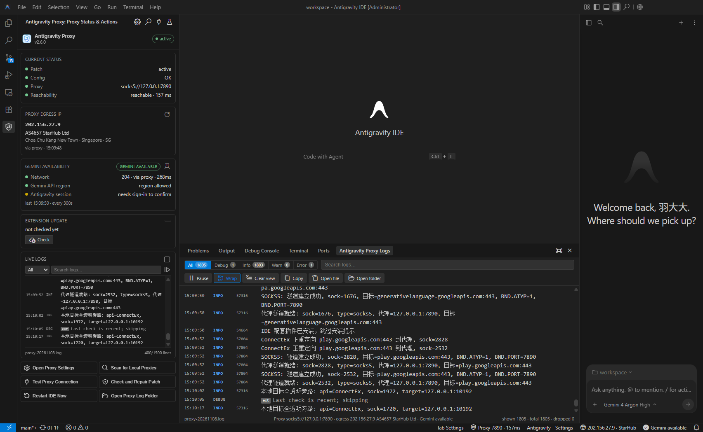

# IDE 插件本轮改造：实时日志 / 出口 IP·运营商 / Gemini 检测 / 插件自更新

> 对应需求：四项（GitHub Release 自更新、实时日志窗口、底部 IP·运营商、左侧栏重构 + Gemini 定时检测）。
> 代码目录：`resources/ide-extension/`；本文所有结论都以实际代码与本次实测为据，不含推测。

## 1. 背景与目标

插件此前只做三件事：状态栏、配置面板、补丁守护（见 [ide-extension.md](ide-extension.md)）。本轮补齐四个"使用面"能力：

1. **插件自更新**：用户不必再手动下载 VSIX；按「本地代理 → GitHub 镜像 → 直连」检查 Release 并安装。
2. **实时日志**：DLL 日志只能"打开目录"，排障要离开 IDE；需要内置窗口、级别筛选与关键字搜索。
3. **出口 IP / 运营商**：Antigravity 的 agent 失败常由出口 IP 的地区/机房属性导致（见 [agent-ip-diagnosis.md](agent-ip-diagnosis.md)），需要随时可见。
4. **左侧栏重构 + Gemini 检测**：原 TreeView 无法承载日志/搜索/卡片；需要 WebviewView，并把 Gemini/Antigravity 可用性做成可定时、可联动的状态。

## 2. 架构与新增模块职责

```
extension.js                         组装：服务创建、命令、定时器、模型刷新（extension.js:110 起）
lib/httpClient.js                    HTTPS：直连 / SOCKS5 / HTTP CONNECT，重定向、超时、下载与 SHA256
lib/tunnel.js                        SOCKS5（RFC1928/1929）与 HTTP CONNECT 握手
lib/githubRelease.js                 Release 解析、版本比较、按架构选 VSIX、镜像与源候选（纯逻辑）
lib/updater.js                       自更新状态机：检查 → 下载 → 校验 → 安装 → 提示重载
lib/ipInfo.js                        出口 IP / ASN / 运营商 / 机房特征（经代理查询，直连兜底）
lib/geminiCheck.js                   Gemini/Antigravity 三层判定与 Antigravity 日志证据
lib/logTail.js                       日志发现 + 增量尾随（截断、跨天、UTF-8 半行）
lib/logService.js                    环形缓冲 + 200ms 批量广播（DLL 日志 + 插件事件）
lib/logView.js                       底部面板日志 WebviewView + 编辑器标签页兜底
lib/sidebarView.js                   左侧栏 WebviewView 宿主
lib/statusBar.js                     三个状态栏条目：主状态 / 出口 IP / Gemini
lib/webviewHtml.js                   Webview CSP/HTML（nonce、资源 URI、首帧 data-*）
media/sidebar.js + sidebar.css       左侧栏前端
media/logview.js + logview.css       日志窗口前端
media/i18n.js                        三语词条（475 条）
```

设计原则：

- **宿主做 IO、Webview 只做展示**：与配置面板一致，文件读写、网络请求全在扩展宿主。
- **纯逻辑可单测**：版本比较、日志解析、ipinfo 解析、Gemini 分类都不依赖 `vscode`，因此可以用 `node --test` 覆盖。
- **安全边界不放松**：只允许 https；安装包必须匹配 `SHA256SUMS.txt`；不执行脚本；不替换安装目录的 `version.dll`。

## 3. 自更新链路

### 3.1 源优先级

```
本地代理（config.json） → GitHub 镜像（按配置顺序） → 直连
```

- 与在线安装脚本的路线一致（`scripts/install-online.ps1:287-301`），避免两套行为。
- 镜像必须是 https，且**能转发 `https://api.github.com`**：默认 `https://gh-proxy.com/`（本次实测返回 v2.6 Release JSON）与 `https://wget.la/`（`install-online.ps1:73` 的实测注释）。
- 不支持 `api.github.com` 的镜像（如 fastgit.cc）会自然失败并被跳过。

### 3.2 检查与资产选择

- API：`https://api.github.com/repos/yuaotian/antigravity-proxy/releases/latest`（与 DLL 的 UpdateChecker 同源，`src/update/UpdateChecker.cpp:25`）。
- 版本比较：去掉 `v` 前缀，按数字段比较（`2.6.0 == v2.6`）。
- 资产：按 `process.arch` 选 `antigravity-proxy-<tag>-ide-extension-win-x64/x86.vsix`；没有对应资产只提示、不安装。

### 3.3 下载、校验与安装

1. 从同一源候选链下载 VSIX 到插件的 `globalStorage/updates/<tag>/`。
2. 拉同版本 `SHA256SUMS.txt`（同样是代理→镜像→直连），比对 SHA256；**不匹配或拿不到清单一律不安装**。
3. 安装优先 `workbench.extensions.installExtension`（VS Code 官方内置命令，支持本地 VSIX URI）；失败回退 `bin\antigravity-ide.cmd --install-extension <vsix> --force`（与 `src/ide/IdeExtensionPrompt.cpp:455-462` 同源）。
4. 安装完成后提示重载窗口（运行中的扩展宿主不会自动切换版本，见 `microsoft/vscode#345106`）。

### 3.4 默认行为

| 设置 | 默认 | 说明 |
|:--|:--|:--|
| `antigravityProxy.update.enabled` | `true` | 参与自动检查 |
| `antigravityProxy.update.mode` | `notify` | 先提示；`auto` 才静默下载安装 |
| `antigravityProxy.update.delaySeconds` | `20` | 启动后延迟 |
| `antigravityProxy.update.intervalHours` | `6` | 检查间隔 |
| `antigravityProxy.update.mirrors` | `["https://gh-proxy.com/", "https://wget.la/"]` | 必须是可转发 api.github.com 的 https 镜像 |

- 同一新版本只提示一次（`globalState` 记录）；开发版 `0.0.0` 不检查。
- 失败时只写日志/更新卡片，不打断用户；手动检查失败会弹一次警告。

## 4. 日志窗口

### 4.1 数据来源

- 目录优先级：`<安装目录>\logs` → `%TEMP%\antigravity-proxy-logs`（与 `src/core/Logger.hpp:130-157` 一致）。
- 文件：`proxy-YYYYMMDD.log`；行格式 `[时间] [PID][TID] [调试|信息|警告|错误] 内容`（`Logger.hpp:364-394`）。
- 单文件 10MB 后**就地覆盖**（`Logger.hpp:245-290`），尾随器检测到 `size < offset` 时从 0 重新读并清空视图缓冲。
- 跨天换文件时自动跟随最新文件并插入"文件已切换"提示。

### 4.2 窗口与交互

- 底部面板容器 `antigravityProxyLogs` + WebviewView `antigravityProxy.logs`；命令 `antigravityProxy.openLogsWindow` 切到该容器。
- 命令不可用时自动打开编辑器标签页（同一份前端与消息协议）。
- 功能：级别筛选（全部/调试/信息/警告/错误）、关键字搜索并高亮、暂停/继续、自动换行、清空视图（不删文件）、复制可见内容、打开日志文件/目录。
- 页脚固定展示「代理地址 · 出口 IP/运营商 · Gemini 结论」（需求 3/4 的"底部面板信息区"）。
- 左侧栏提供紧凑日志（最近 1500 行、渲染上限 400 行）。

### 4.3 性能与边界

- 宿主环形缓冲默认 3000 行；200ms 批量广播，避免日志量大时打爆 Webview 消息通道。
- 首次只回放文件尾部 256KB；渲染上限：日志窗口 1000 行、侧栏 400 行。

## 5. 出口 IP 与 Gemini 判定

### 5.1 出口 IP / 运营商

- 经当前代理请求 `https://ipinfo.io/json`；代理失败才回退直连，并在 UI 标注 `via=direct`（避免把直连出口误当代理出口）。
- 解析 `ip / org（AS4657 StarHub Ltd → ASN + 名称）/ country / region / city / timezone`。
- 机房/托管关键字与 DLL 诊断同源（`src/hooks/Hooks.cpp:493-505`），命中时显示"机房 IP"警告。
- 缓存 30 分钟；默认 1800 秒刷新；可关闭。状态栏条目：`$(globe) <ip> · <运营商首词>`。

### 5.2 为什么 Gemini 不能只 ping

- Google 对 Gemini API 与 Antigravity 都按出口 IP 实时判定；官方论坛明确 Antigravity 消费级登录要求"受支持国家 + 被识别为受支持位置的出口"，VPS/机房出口会被拒（`discuss.ai.google.dev/t/190622`）。
- Antigravity agent 链路的独立门是 `POST https://daily-cloudcode-pa.googleapis.com/v1internal:loadCodeAssist`，被拒时返回 `403 PERMISSION_DENIED / UNSUPPORTED_LOCATION / error_number 1008`。
- 也存在出口 IP 正确、但账号资格导致 1008 的案例（`github.com/google-antigravity/antigravity-cli/issues/1133`），所以客户端无法 100% 代替服务端判定。

### 5.3 三层判定（UI 分行展示）

| 层 | 探测 | 判定 |
|:--|:--|:--|
| 网络 | 经代理 GET `https://www.gstatic.com/generate_204` | 200/204 可达；代理失败自动回退直连并标记 |
| Gemini API 区域 | GET `https://generativelanguage.googleapis.com/v1beta/models?key=<无效 key>` | 命中 `User location is not supported` → 受限；命中 `API key not valid`/`API_KEY_INVALID` → 地区放行；其它 → 无法判定 |
| Antigravity 会话 | POST `loadCodeAssist`（空 JSON）+ 读取 `%APPDATA%\Antigravity\logs\<最新>\ls-main.log` | 403/1008 或日志命中 → 明确受限；401/无日志 → 无法判定 |

- 定时：`antigravityProxy.gemini.intervalSeconds` 默认 300 秒（最小 60，0 关闭）；结论同步到左侧栏与状态栏。
- 状态栏：`$(pass-filled) Gemini 可用` / `$(warning) Gemini 区域受限` / `$(question) 无法判定` / `$(error) 不可达`；代理异常单独一档。
- 设计取舍：**不用一个对勾概括**。无法判定时保留"无法判定"，避免误导用户去改 DNS/重装。

## 6. 配置项与默认值

| 设置 | 默认 | 作用 |
|:--|:--|:--|
| `antigravityProxy.statusBar.showEgress` | `true` | 显示出口 IP 条目 |
| `antigravityProxy.statusBar.showGemini` | `true` | 显示 Gemini 条目 |
| `antigravityProxy.egress.refreshIntervalSeconds` | `1800` | 出口 IP 刷新间隔（0=仅手动；最小 60） |
| `antigravityProxy.gemini.intervalSeconds` | `300` | Gemini 检测间隔（0=关闭；最小 60） |
| `antigravityProxy.update.enabled` | `true` | 自动检查插件更新 |
| `antigravityProxy.update.mode` | `notify` | `notify` / `auto` |
| `antigravityProxy.update.delaySeconds` | `20` | 启动后首查延迟 |
| `antigravityProxy.update.intervalHours` | `6` | 检查间隔 |
| `antigravityProxy.update.mirrors` | gh-proxy.com / wget.la | 必须可转发 api.github.com |

原有设置（语言、autoRestore、statusBar.enabled、probeIntervalSeconds）保持不变。

## 7. 验证清单与已知限制

### 7.1 单元测试（node --test）

| 文件 | 覆盖 |
|:--|:--|
| `test/githubRelease.test.js` | 版本比较、Release 解析、按架构选 VSIX、镜像拼接、SHA256SUMS |
| `test/logTail.test.js` | 日志行解析、尾部回放、追加、截断重置、跨目录选最新、广播服务 |
| `test/ipInfo.test.js` | org 拆分、机房关键字、ipinfo 解析与非法响应 |
| `test/geminiCheck.test.js` | Gemini API / loadCodeAssist 分类、Antigravity 日志证据 |
| `test/i18n.test.js` | 三语词条齐全、占位符一致、源码引用 key 存在（含新前端） |

### 7.2 离线冒烟（实现阶段已做）

- 本地临时 SOCKS5 与 HTTP CONNECT 代理：两种隧道均能取回 v2.6 Release JSON；
- `SHA256SUMS.txt` 经代理下载并解析（6 条目）；
- 日志尾随/截断重置、状态栏三分项渲染、两个 Webview 的 HTML/init 消息。

### 7.3 IDE 实机验证（隔离副本）

见 `docs/ide-extension.md` 第 9 节的方法：复制安装目录到临时目录，用临时 `--user-data-dir`/`--extensions-dir` 安装 VSIX，再以 `--remote-debugging-port` 启动、通过 CDP 驱动。**不触碰正在使用的 IDE**。


### 7.4 已知限制

- 自更新安装后必须重载窗口；`auto` 模式也不会自动刷新窗口。
- 拿不到 `SHA256SUMS.txt` 时不安装，只给 Release 链接。
- Gemini/Antigravity 判定是客户端近似，账号资格维度无法从客户端确认。
- ipinfo 免费额度有限，已做缓存与最小间隔。
- 日志窗口只读；DLL 在 10MB 时就地覆盖，历史内容不可追回。

## 8. 实测记录（2026-11-08，Antigravity IDE 1.107.0）

环境：Windows；IDE 版本 1.107.0；本地 SOCKS5 `127.0.0.1:7890`。测试全程使用临时 `--user-data-dir` / `--extensions-dir`（隔离副本），未触碰正在使用的 IDE；最后才把最终 VSIX 安装到本体。

| 项目 | 结果 |
|:--|:--|
| VSIX 打包 | 48 个条目，全部 `/` 分隔（无 `\\` 条目）；Identity `2.6.0`；含全部新增 lib/media、`payload/version.dll`（718848 字节）与 `payload/config.json` |
| JS 单测 | 10 个测试文件、56 个用例全部通过 |
| 安装（隔离） | `--install-extension` 退出码 0；`extensions.json` 出现 2.6.0；旧版本目录被替换 |
| 冷启动 | 侧栏 v2.6.0；补丁 active、配置 OK、代理 7890 可达；出口 IP `202.156.27.9 / AS4657 StarHub Ltd / Singapore`；Gemini 三层为 `204 via proxy` / `region allowed` / `needs sign-in to confirm` |
| 状态栏 | 主状态、`202.156.27.9 · StarHub`、`Gemini available` 三项同时存在，点击可见卡片 |
| 日志搜索/筛选 | 预先写入的 `AGP-TEST-20261108-MARKER` 被命中且高亮；Error 级别筛选只保留错误行 |
| 日志窗口 | 底部面板标签存在；渲染 1000 行（总数 1805）；文件名、环境条、级别计数正确；暂停/换行/复制/打开文件按钮可用 |
| 自更新 | 用伪造的 2.5.0 VSIX 安装后，检查到 `v2.6`；点“立即更新”经 config proxy 下载、SHA256 校验通过、`workbench.extensions.installExtension` 安装成功；`extensions.json` 变为 2.6.0；重载后侧栏 v2.6.0 |
| 本体安装 | `bin\antigravity-ide.cmd --install-extension output\ide\antigravity-proxy.vsix --force` 成功，本体 `extensions.json` 为 2.6.0；需重载窗口生效（安装目录 `version.dll` 仍为 2.3，按补丁守护“只补缺失、不覆盖”策略未替换） |

实机测试中发现并已修复的问题：

1. 侧栏 Gemini 行的 id 与 `tagRow` 生成规则不一致，导致三行数值不显示（`resources/ide-extension/media/sidebar.js`）。
2. 日志文件在视图打开后才出现时，页脚一直显示“暂无日志文件”（`logService.js` 增加 `file` 事件）。
3. `IpInfoService` / `ExtensionUpdater.onDidChange` 返回裸函数并被塞进 `context.subscriptions`，扩展停用时抛 `AggregateError`（改为返回 `{ dispose }`）。
4. 日志窗口的插件事件没有 PID 时，消息落入 52px 的 PID 列，表现为右侧逐字换行（PID 列改为始终渲染）。
5. 日志窗口环境条出现“Gemini Gemini available”重复（词条去掉字面量 Gemini）。



说明：隔离测试用 `--locale=zh-cn` 启动，但该 IDE 构建仍按英文渲染扩展文案（`vscode.env.language` 为 en），因此截图为英文；三语词条本身已由单测覆盖。
