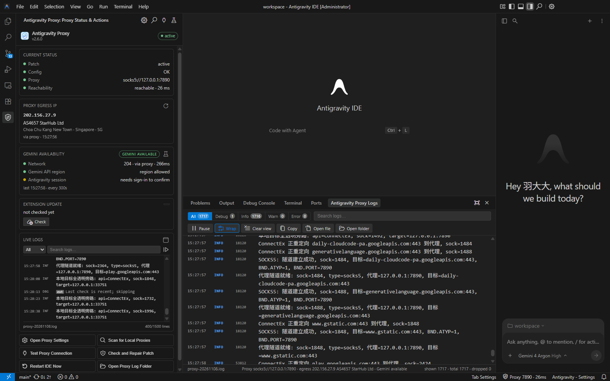
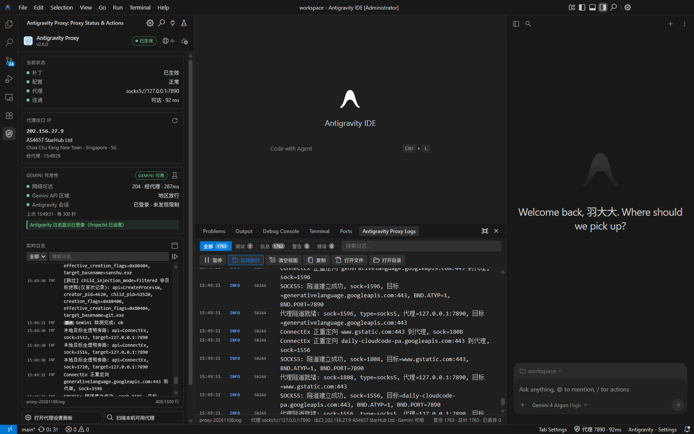
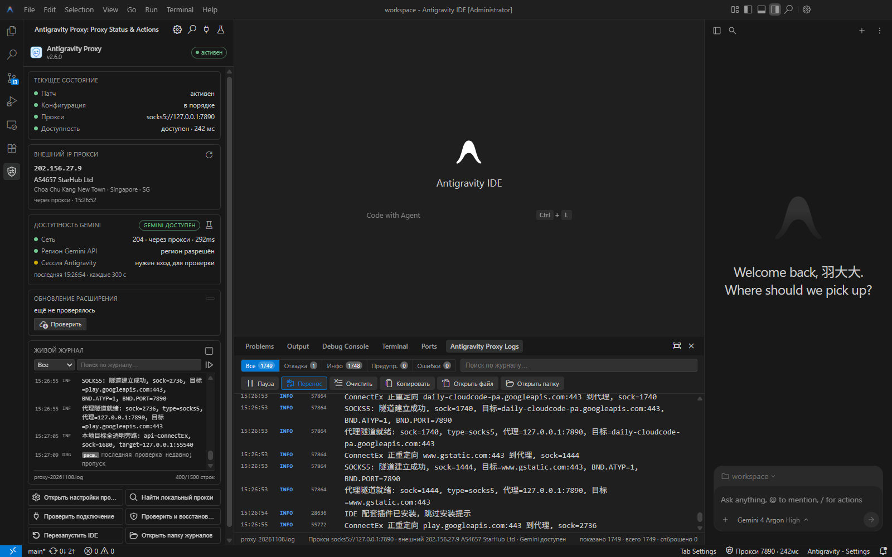

# Antigravity Proxy

Companion extension for **Antigravity IDE on Windows**.

It shows the proxy/patch status, egress IP and ISP, Gemini/Antigravity reachability, live logs and a visual
`config.json` editor. If an IDE update removes the proxy patch, the extension restores it from its bundled
payload on the next start.

## Screenshots

| English | 简体中文 | Русский |
|:--:|:--:|:--:|
|  |  |  |

## Install

### From Open VSX (recommended)

Open [Antigravity Proxy on Open VSX](https://open-vsx.org/extension/yuaotian/antigravity-proxy), or run:

```powershell
& "$env:LOCALAPPDATA\Programs\Antigravity IDE\bin\antigravity-ide.cmd" --install-extension yuaotian.antigravity-proxy
```

If the IDE search index has not caught up yet, download the VSIX from the Open VSX page and use
**Extensions → … → Install from VSIX**.

### From VSIX

Download `antigravity-proxy-2.6.3.vsix` from [GitHub Releases](https://github.com/yuaotian/antigravity-proxy/releases)
or the Open VSX page, then:

```powershell
& "$env:LOCALAPPDATA\Programs\Antigravity IDE\bin\antigravity-ide.cmd" --install-extension .\antigravity-proxy-2.6.3.vsix --force
```

Reload the IDE window after installation.

## 简体中文

**Antigravity IDE 的代理配套插件（Windows）。** 提供补丁/代理/连通状态、出口 IP 与运营商、Gemini/Antigravity
可用性、实时日志、可视化配置，以及 IDE 更新后自动恢复 `version.dll`。

**安装（Open VSX）：**

```powershell
& "$env:LOCALAPPDATA\Programs\Antigravity IDE\bin\antigravity-ide.cmd" --install-extension yuaotian.antigravity-proxy
```

也可以打开 [Open VSX 页面](https://open-vsx.org/extension/yuaotian/antigravity-proxy) 下载 VSIX，在扩展视图右上角
`…` → 「从 VSIX 安装」。安装后执行 `Reload Window`。

## Русский

**Сопутствующее расширение для прокси в Antigravity IDE (Windows).** Показывает состояние патча/прокси,
внешний IP и провайдера, доступность Gemini/Antigravity, живой журнал, визуальные настройки и восстанавливает
`version.dll` после обновления IDE.

**Установка из Open VSX:**

```powershell
& "$env:LOCALAPPDATA\Programs\Antigravity IDE\bin\antigravity-ide.cmd" --install-extension yuaotian.antigravity-proxy
```

Либо скачайте VSIX со [страницы Open VSX](https://open-vsx.org/extension/yuaotian/antigravity-proxy) и выберите
**Extensions → … → Install from VSIX**. После установки выполните `Reload Window`.

## Links

- Repository: https://github.com/yuaotian/antigravity-proxy
- Documentation: https://github.com/yuaotian/antigravity-proxy/blob/main/docs/ide-extension.md
- Issues: https://github.com/yuaotian/antigravity-proxy/issues
- License: BSD-2-Clause (see `LICENSE.txt`)
